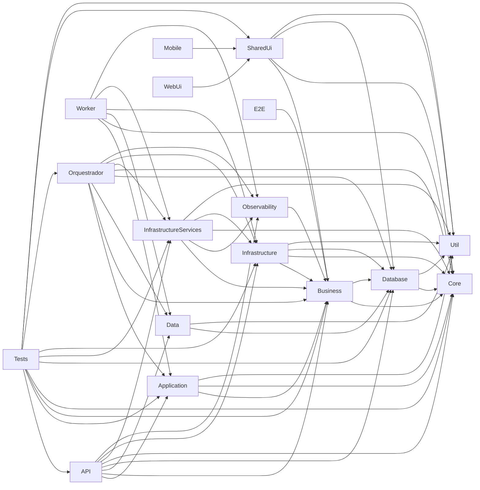
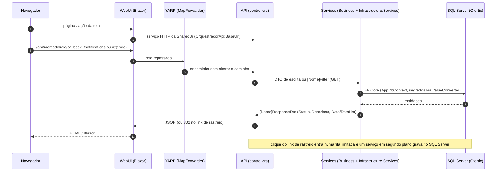
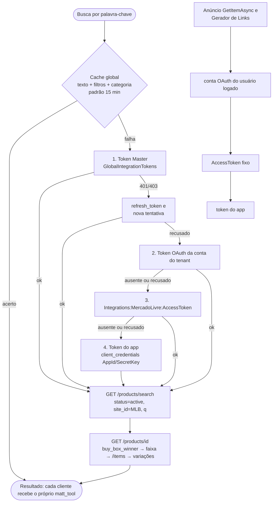
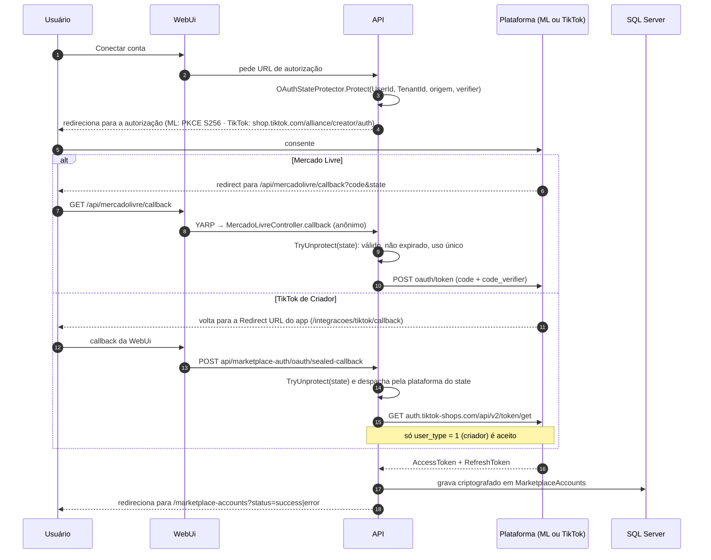
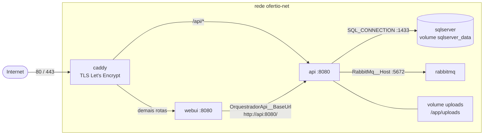

# 🗺️ Diagramas de Arquitetura

> Visão em Mermaid de como o Ofertio se conecta. As regras que sustentam cada fluxo estão em [backend-architecture.md](./rules/backend-architecture.md) e [marketplaces-oauth.md](./rules/marketplaces-oauth.md); o roteiro de produção em [CONFIGURACAO_PRODUCAO_DOCKER.md](./CONFIGURACAO_PRODUCAO_DOCKER.md). A versão anterior está em [arquivo/](./arquivo/DIAGRAMAS_ARQUITETURA_2026.md).

## 1. Dependências entre projetos

Gerado dos `<ProjectReference>` dos `.csproj` por [scripts/gerar-diagrama-dependencias.ps1](../scripts/gerar-diagrama-dependencias.ps1). Quando uma referência mudar, rode `powershell -File scripts\gerar-diagrama-dependencias.ps1` e cole a saída no lugar do bloco abaixo (seta = "depende de"; `InfrastructureServices` = `Ofertio.Infrastructure.Services`).



## 2. Requisição WebUi → YARP → API → SQL Server

O host público é o da WebUi; a API só escuta internamente (`OrquestradorApi:BaseUrl`). As rotas cadastradas nos apps de terceiros e o link de rastreio passam pelo YARP (`MercadoLivreProxyExtensions`, `AllowAnonymous`). Não existe subaplicação `/api` no site da WebUi.



## 3. Busca do Mercado Livre só pela API oficial (ordem dos tokens)

Sempre `Authorization: Bearer`, nunca token na URL; sem raspagem, sem busca anônima e sem contornar captcha (`MercadoLivreAntiBotGuard` suspende os GETs públicos por 15 min).



Cada degrau só é usado se o anterior não existir ou for recusado. Rotinas em segundo plano nunca usam a conta de outro tenant.

## 4. OAuth com state selado (Mercado Livre e TikTok de Criador)

O `state` é selado por `OAuthStateProtector` (AES-256-GCM, chave HKDF de `Encryption:Key`) e leva `UserId`, `TenantId`, apelido, origem e, no ML, o `code_verifier` do PKCE. Validade de 15 min e uso único; por isso o callback é anônimo.



## 5. Checkout e cobrança do plano

Hoje são dois fluxos separados. O checkout do cliente usa o gateway simulado (aprova sem cobrar) e só registra o pedido. A cobrança real nasce no Master, e o webhook do ASAAS só ativa o tenant e renova. Quem grava `PlanCode`/`BillingCycle` é o Master (`TenantAdminService`). Número, CVV e validade do cartão só trafegam até o gateway: o pedido guarda bandeira e 4 últimos dígitos.

```mermaid
sequenceDiagram
    autonumber
    participant U as Usuário
    participant M as MyPlanService.CheckoutAsync
    participant G as SimulatedPlanPaymentGateway
    participant D as SQL Server
    participant MS as Master (TenantAdminService)
    participant AS as Gateway ASAAS
    participant WH as AsaasWebhookController
    participant WS as AsaasWebhookService

    rect rgb(240,240,240)
    Note over U,D: Fluxo A: checkout do cliente (fase de telas)
    U->>M: plano + ciclo + CreditCardDto
    M->>M: valida conta, ciclo, dados cadastrais e cartão
    M->>G: ChargeAsync (aprova sem cobrar)
    G-->>M: status Simulated
    M->>D: PlanCheckouts (bandeira, last4, status); não altera o Tenant
    M-->>U: PlanCheckoutResponseDto
    end
    rect rgb(235,245,255)
    Note over MS,D: Fluxo B: cobrança iniciada pelo Master
    MS->>D: grava Tenant.PlanCode e BillingCycle
    MS->>AS: CreateSubscriptionAsync
    AS-)WH: POST api/webhooks/asaas (header asaas-access-token)
    WH->>WS: ValidateTokenAsync (401 se inválido) e HandleAsync
    WS->>D: SaasPayments por GatewayPaymentId
    alt PAYMENT_CONFIRMED / RECEIVED
        WS->>D: Tenant Ativo e RenewalAt +1 mês (anual: +1 ano)
    else PAYMENT_OVERDUE
        WS->>D: Tenant Inadimplente
    end
    WS-)U: e-mail de aviso do plano
    end
```

## 6. Produção Docker

Só o Caddy publica portas no host. Entre containers o tráfego é HTTP e o TLS termina no Caddy (rede `ofertio-net`, VPS em `/var/www/ofertio`). Os Dockerfiles, o `Caddyfile` e o `docker-compose.yml` da aplicação ainda não estão no git.


