# 🏗️ DIAGRAMAS VISUAIS: ARQUITETURA ATUAL vs PROPOSTA

[« Voltar para o Índice Completo](./INDICE_COMPLETO.md) · [README principal](../README.md) · [Lista de mudanças](./LISTA_ARQUIVOS_MUDANCAS.md)

> **Raiz da solution:** `c:\Programacao\Tecso.AutomacaoCusor\` (`Ofertio.sln`).  
> **Painel de controle:** [README.md](../README.md) · **Varredura física:** 3 de junho de 2026  
> **Divergências / limpeza:** [LISTA_ARQUIVOS_MUDANCAS.md](./LISTA_ARQUIVOS_MUDANCAS.md)

---

## 🔌 INTEGRAÇÕES EXTERNAS — TikTok Shop & Shopee (Fase 3)

> **Estratégia de acoplamento (jun/2026):** contratos e opções de configuração ficam em **`Ofertio.Business/Integrations/`**; implementações HTTP (HttpClient nomeado, Polly, logging handler) ficam em **`Ofertio.Infrastructure.Services/Integrations/`**. Os serviços legados em `Business/Interfaces/Services/` (`ITikTokShopApi`, `IShopeeApi`) serão gradualmente adaptados para delegar aos novos *Integration Clients* nas fases 3.2–3.4.

```
Ofertio.Business/Integrations/
├── Common/                          # Opções compartilhadas, nomes de HttpClient
├── TikTokShop/                      # ITikTokShopIntegrationClient + Options (AppKey/AppSecret)
└── Shopee/                          # IShopeeIntegrationClient + Options + sandbox (tecflow_sandbox_subid)

**Minhas Lojas / Busca:** `POST /api/marketplace-auth/vincular-manual` persiste `MarketplaceAccounts` com `UserId` existente em `Usuarios` e `TenantId` de um registro real em `Tenants` (`Tenant Principal` se a tabela estiver vazia), evitando `FK_MarketplaceAccounts_Tenants_TenantId`. No Mercado Livre o campo aceita link de afiliado ou só o número; `ConnectStoreManualLinkForm` / `MarketplaceAccountService` extraem `matt_tool` (ou expandem `meli.la`/`/sec/` com `UrlUnshortenerService`) e gravam o ID numérico em `TrackingId`. A `/busca` localiza a loja ativa por `MarketplaceType.MercadoLivre` ou nome compacto (`Mercado Livre` → `MercadoLivre`). A pesquisa MLB usa `Bearer` + `access_token` em `sites/MLB/search` com o token OAuth da loja; sem ele, `MercadoLivreApiService` pede um token de aplicação (`grant_type=client_credentials`) com `AppId`/`SecretKey` do Vault Master (`IOptionsMonitor`, cache até 5 min antes de expirar). HTTP 401/403 ou erro de escopo cai automaticamente na vitrine `lista.mercadolivre.com.br/{query}` (`MercadoLivreHtmlParser`), sempre com `matt_tool` injetado; se a vitrine responder o challenge `account-verification`, o badge mostra o erro de 403. Sem credenciais e com a vitrine bloqueada o badge fica `⚠️ Requer OAuth...`. O ID de afiliado só injeta `matt_tool` nos permalinks. O token vem do OAuth em Minhas Lojas: `MinhasLojas` ➔ `MarketplaceOAuthConnectService` ➔ `GET api/marketplace-auth/mercadolivre/authorize-url` (`MarketplaceAuthService`) ➔ `auth.mercadolivre.com.br/authorization` ➔ `WebUi /integracoes/oauth/callback` (reenvia do túnel HTTPS para a origem com cookie) ➔ `POST api/integracoes/vincular` ➔ `IntegracaoLojaService` ➔ `ExchangeMercadoLivreCodeAsync` (`oauth/token`, `authorization_code`) ➔ `MarketplaceAccounts.AccessToken/RefreshToken` da loja ML existente. O placeholder `homolog-test-access-token` do Universal Link é tratado como ausência de OAuth. `FriendlyName` e `TrackingId` seguem no corpo JSON; após sucesso a modal fecha e `MinhasLojas` recarrega a lista.

```mermaid
flowchart LR
  STR[ShopeeLinkStrategy]
  AFF[ShopeeAffiliateLinkClient]
  BLD[ShopeeCommissionUrlBuilder]
  SHORT[ShortAffiliateLink]
  SQL[(SQL Server Ofertio)]
  LOG[LinkClickLog]

  STR -->|shopId/itemId| UNI[universal-link/product]
  UNI -->|sub_id TrackingId ou FriendlyName| AFFURL
  STR -.->|Open API opcional não bloqueia| AFF
  STR -->|deep_link nativo| BLD
  BLD --> SHORT
  SHORT -->|SaveChangesAsync| SQL
  EXP[UrlExpansionService] -->|Location meta-refresh window.location| LOOP[UrlUnshortenerService while 5]
  LOOP -->|marketplace Amazon Shopee Magalu ML Kabum TikTok CB| ENG[UniversalLinkResolverEngine]
  ENG -->|valida dominio so apos o loop| META
  UNI -->|dominio para MarketplaceAccounts| PLAT[Amazon Magalu Kabum Shopee ML CB TikTok]
  UN -->|strip partner_id/promoter_id| MAG[MagazineLuizaCommissionUrlBuilder promoter_id]
  ACC[MarketplaceAccounts] -->|AreSamePlatform Magalu| SCOPE[IntegracaoLojaScopeResolver]
  SHORTSVC[ShortAffiliateLinkService] --> SCOPE
  MAG --> AFFURL
  OPEN[ShopeeService Open API get_item_base_info] -->|AppKey/AppSecret MarketplaceAccounts| META
  UI -->|Gerar Link de Comissão| META
  LOJAS[MarketplaceAccounts] -->|SaveChangesAsync| SQL
  SHORT --> LOG
  BLD --> AFFURL[AffiliateUrl longa]
  BLD --> SHPEE[ShortenedShopeeUrl br.shp.ee]
  SHORT --> SHORTURL[ShortenedUrl localhost:5001/storeSlug/code]
  UI[GeradorLinks.razor] -->|POST /api/links/convert| API[AffiliateLinksController]
  TT[TikTokShopLinkStrategy]
  TTB[TikTokShopCommissionUrlBuilder]
  TT -->|productId + sub_id TrackingId/FriendlyName| TTAFF[shop.tiktok.com/view/product]
  TTB --> TTAFF
  TTAFF --> SHORT
  ML[MercadoLivreLinkStrategy]
  MLB[MercadoLivreCommissionUrlBuilder]
  ML -->|matt_tool TrackingId / matt_word FriendlyName| MLAFF[mercadolivre.com.br/p/MLB]
  MLB --> MLAFF
  MLAFF --> SHORT
  AMZ[AmazonLinkStrategy]
  AMZB[AmazonCommissionUrlBuilder]
  AMZ -->|ASIN + tag TrackingId| AMAFF[amazon.com.br/dp/ASIN]
  AMZB --> AMAFF
  AMAFF --> SHORT
  MAG[MagazineLuizaLinkStrategy]
  MAGB[MagazineLuizaCommissionUrlBuilder]
  MAG -->|loja parceira ou parceiro=| MAGAFF[magazinevoce.com.br/loja/p/id]
  MAGB --> MAGAFF
  MAGAFF --> SHORT
  KB[KabumLinkStrategy]
  KBB[KabumCommissionUrlBuilder]
  KB -->|productId + sub_id TrackingId| KBAFF[kabum.com.br/produto/id]
  KBB --> KBAFF
  KBAFF --> SHORT
  CB[CasasBahiaLinkStrategy]
  CBB[CasasBahiaCommissionUrlBuilder]
  CB -->|parceiro TrackingId / sub_id FriendlyName| CBAFF[casasbahia.com.br/p/id]
  CBB --> CBAFF
  CBAFF --> SHORT
  UI -->|Casas Bahia cb.com.br| CB
  UI -->|seletor Todas / outra plataforma| LOJAS
  LOJAS -->|primeira conta IsActive da plataforma| SHORT
  UI -->|Kabum kb.um| KB
  UI -->|Magalu magalu.me| MAG
  UI -->|Amazon URLs amzn.to a.co| AMZ
  UI -->|Mercado Livre URLs| ML
  HIST[HistoricoLinks] -->|GET historico TenantId + IsActive (abas PlatformType)| API
  HIST -->|lapis abre modal contas + nome/preco| UI
  UI -->|floppy PUT metadata ProductPrice ProductName| API
  PUB[PublicConverter.razor /p/slug] -->|GET slug ativo ou inativo| PC[PublicConverterController]
  PUB -->|DistinctBy PlatformType um badge compacto| ACC
  PUB -->|POST convert FirstOrDefault conta ativa| GEN[AffiliateLinkGenerationService]
  PUB -->|Limpar zera input e oculta resultados| PUB
  PUB -->|Copiar JS clipboard + Abrir _blank| CLIP
  GEN -->|ShortAffiliateLinks Source=PublicPage UserId afiliado| SQL
  MINE[MinhasPaginasPublicas] -->|historico slug badge Inativo| PC
  HIST -->|badge Pagina publica| SQL
  UI -->|checkboxes StoreIds| API
  ACCNT[ShortAffiliateLinkAccount IsActive] -->|inativação lógica| SQL
  API --> STR
  MINHAS[MinhasLojas.razor] -->|GET/POST marketplace-auth| ACC[MarketplaceAccountsController]
  ACC --> LOJAS
  PANEL[LinkGeneratorResultPanel] -->|ofertioClipboard.copyText| CLIP[ofertio-clipboard.js]
  PANEL -->|WhatsApp / Telegram encoded URI| SHARE[api.whatsapp.com / t.me]
  NAV[NavMenu InteractiveServer] -->|Próximos accordion isProximosOpen| DASH[Dashboard.razor]
  NAV -->|Integrações Gerador de Links| GER[GeradorLinks.razor]
  NAV -->|Integrações Minhas Lojas única| MINHAS
  NAV -->|Integrações Páginas Públicas| MINE
  NAV -->|Mensageria Conexões| CX[Conexoes.razor]
  NAV -->|Mensageria Bot de Conversão| BOTC[BotConversor.razor]
  NAV -->|Mensageria Agendador de Grupos| AGHUB[Agendador.razor]
  NAV -->|WhatsApp Agendador| WAAGEN
  NAV -->|Telegram Agendador| TGAGEN
  CX -->|abas WhatsApp Telegram| WAUI[WhatsAppConexao.razor]
  WAUI -->|POST conectar + GET status polling| WAPI[WhatsAppIntegrationController]
  WAPI --> WAS[WhatsAppSessionService]
  WAS --> EVO[EvolutionApiService]
  EVO -->|try/catch + log Body HTTP 40x/50x| EVAPI[Evolution API]
  EVO -->|already exists 400/409| EVOQR[FetchQrCodeAsync]
  WAS -->|WhatsAppIntegrations UserId InstanceName| SQL
  EVOWH[WhatsAppWebhookController] -->|X-Webhook-Secret + MESSAGES_UPSERT| WPROC[WhatsAppMessageProcessor]
  WPROC -->|regex URL + PlatformLinkResolver + loja ativa| GEN
  WPROC -->|GroupOfferCaptureService grupos| GCAP[GroupCapturedMessages]
  GCAP --> SQL
  MONUI[GruposMonitorados.razor WA/TG] -->|channel WhatsApp ou Telegram| MONAPI[MonitoredGroupsController]
  MONAPI -->|IUserContextProvider DI + fallback 1| MONSVC[MonitoredGroupService]
  MONSVC -->|try/catch isolado Evolution| WASYNC[WhatsAppBroadcastService SyncGroups]
  MONSVC -->|try/catch isolado Telegram| TGSYNC[TelegramBroadcastService SyncChannels]
  MONSVC --> VAL[OfferValidationService]
  MONSVC -->|GenerateAsync GroupClone| GEN
  MONUI -->|clone query| WAAGEN
  WPROC -->|ShortAffiliateLinks Source=WhatsAppBot| SQL
  WPROC -->|EnsureOwner UserId vs tecflow-u{id}| WPROC
  WPROC -->|sendText 3s| EVO
  TGWH[TelegramWebhookController] -->|X-Webhook-Secret ou X-Telegram-Bot-Api-Secret-Token| TPROC[TelegramMessageProcessor]
  TPROC -->|regex URL + PlatformLinkResolver + loja ativa UserId| GEN
  TPROC -->|ShortAffiliateLinks Source=TelegramBot| SQL
  TPROC -->|SendTextMessageAsync 2s| TGAPI[TelegramApiService GetMeAsync SetWebhookAsync]
  TGUI[TelegramConexao.razor] -->|POST conectar BotToken ChatId| TGIC[TelegramIntegrationController]
  CXUI[Conexoes.razor aba Telegram] -->|valida placeholder + POST conectar| TGIC
  CXUI -->|modal isBotFatherHelpModalOpen| HELP[Tutorial BotFather]
  TGIC --> TGIS[TelegramIntegrationService]
  TGIS -->|GetMeAsync 401 aborta| TGAPI
  TGIS -->|try SetWebhookAsync catch log localhost| DISPATCH[Persiste credenciais + Modo Disparo]
  TGAGEN[TelegramAgendador.razor] -->|GetChat Title + SelectedChatIds| TGBC[TelegramBroadcastController]
  TGBC --> TGBS[TelegramBroadcastService]
  TGWORK[TelegramBroadcastWorker] -->|Pending ScheduledAt| TGBS
  USERBOT[TelegramUserMonitorWorker] -->|StartAsync CreateDirectory + BackfillMediaPaths| FOLD[uploads/products + App_Data/telegram-sessions]
  USERBOT -->|OnUpdates TryWrite Channel| QUEUE[Channel UserBotCapturedPayload]
  QUEUE -->|Drain PersistAsync OfferPipelineProcessor| PIPE[Parse filtro loja foto validacao]
  PIPE -->|SaveValidatedOfferAsync INSERT atomico| SQL
  GCAP[GroupOfferCaptureService] -->|delegates OfferPipelineProcessor| PIPE
  USERBOT -->|try-catch LogError| ST[IUserBotSyncStatusService]
  GMUI[GruposMonitorados] -->|HandleResetAllAsync POST resetar só limpa SQL e disco| GCAPSVC
  GMUI[GruposMonitorados] -->|POST sync HTTP 202 EnqueueCatchUp| USERBOT
  GMUI -->|GET /uploads PhysicalFileProvider UploadStorage:RootPath| MEDIA
  APIUP[API Program.cs UseStaticFiles /uploads] -->|PhysicalFileProvider| MEDIA
  UPS[IUploadStorage UploadsRoot MediaRoot] -->|C:\inetpub\ofertio\uploads| MEDIA
  GMUI -->|GET status GetSyncStatus toast| ST
  USERBOT -->|GetHistory chats DialogsSlice + PersistAsync| GCAP
  USERBOT -->|await DownloadMediaAsync + IOfferProductMediaStore| OPT[ImageOptimizationService]
  OPT -->|1080px WebP EXIF strip canvas neutro .tmp + Flush + Move| MEDIA[C:\inetpub\ofertio\uploads\products\tenant\yyyy\MM]
  OPT -->|File.Exists confirmado| STORE[OfferProductMediaStore URL ou null + LogWarning]
  USERBOT -->|UpdateImageUrlAsync UserId GroupKey ExternalMessageId so com arquivo| SQL
  USERBOT -->|download falhou ClearMissingImageUrlAsync ProductImageUrl null| SQL
  USERBOT -->|BackfillMediaPaths {ExternalMessageId}.webp| SQL
  GMUI -->|GET ListAsync DeduplicateOffers Id msg URL| SQL
  APIIIS[OfertioApiPool Integrated Security] -->|login Windows Ofertio| SQL
  USERBOT -->|Backfill ProductImageUrl nulo ou File.Exists falso| MEDIA
  PURGE[ProductImageCleanupWorker] -->|7 dias File.Delete + ProductImageUrl null| MEDIA
  DATAPURGE[DataPurgeWorker 03:00 UTC] -->|PurgeOldMediaFiles jpg/png/webp 7d| MEDIA
  DATAPURGE -->|ColdStorageArchiver SKU preco cupom| HIST[(ProductPriceHistory)]
  DATAPURGE -->|DELETE TOP 5000 14d + REORGANIZE| SQL
  GCAP -->|ValidateProductPageStatusAsync + og:title/og:image| VAL
  PIPE -->|OfferIntegrityRules vitrine /social/ /lists/ /perfil/ rejeita + PrecoSuspeito| INTEG[OfferIntegrityRules]
  VAL -->|URL final vitrine VitrineGenerica / anuncio encerrado Inativo| INTEG
  GMUI -->|Verificar anuncio LiveCheck GET pagina antes das APIs| VAL
  REVAL[OfferRevalidationWorker a cada IntervalHours] -->|OfferRevalidationHost scope| REVSVC[OfferRevalidationService lote Ativo vencidas]
  REVSVC -->|CheckAndPersistAsync Inativo / VitrineGenerica / PrecoSuspeito| SQL
  GMUI -->|Abrir Link Original AffiliateUrl target _blank| AFFURL[AffiliateUrlBuilderService]
  AFFURL -->|TrackingId conta ML do tenant ou DefaultAffiliateTrackingId| SQL
  AFFURL -->|AffiliateUrlBuilderRules matt_tool=97303724| MLSITE[mercadolivre.com.br]
  AFFURL -->|vitrine /social/ affiliate-profile ➔ produto focado + remove matt_* de terceiros| SHOWCASE[MercadoLivreShowcaseRules]
  VAL -->|vitrine com item_id / product_id ➔ GET da página direta do produto| SHOWCASE
  PIPE -->|PrimaryProductUrl = página direta resolvida pelo redirect| SHOWCASE
  GMUI -->|Verificar anuncio ResolvedProductUrl atualiza PrimaryProductUrl| SHOWCASE
  GMUI -->|Clonar Oferta ML usa a URL higienizada do AffiliateUrlBuilderService| AFFURL
  GMUI -->|take padrão OffersPageSize=100 pré-busca take+20 até 200| MONSVC
  RESOLVSOC[UrlResolverService HEAD/GET redirects] -->|vitrine /social/ ➔ /p/ITEM_ID antes do StripForeignTracking| SHOWCASE
  VAL -->|/social/ do ML segue o GET; VitrineGenerica só na URL final| RESOLVSOC
  RESETPS[ResetarOfertasLegadas.ps1] -->|DELETE GroupCapturedMessages + uploads/products| SQL
  MONSVC -->|OrderByCapturedAtDescending ReceivedAt desc + Id desc| TIMERULE[CapturedMessageTimeRules]
  PIPE -->|ReceivedAt UTC = horário de envio da mensagem| TIMERULE
  GMUI -->|card dd/MM/yyyy HH:mm horário de Brasília| TIMERULE
  VAL -->|pausado ➔ Inativo; sem estoque / só Produtos relacionados / redirect lista ➔ Esgotado| MLAVAIL[MercadoLivreAvailabilityRules]
  MONSVC -->|ApplyRelevanceFilter IsAvailable + FeedVisibleStatuses| FEEDVIS[OfferFeedVisibilityRules]
  GMUI -->|Verificar ValidatedOffer / OfferRemoved ➔ remove card + toast Produto esgotado| FEEDVIS
  REVALW[OfferRevalidationService Worker de lote] -->|CheckAndPersistAsync IsAvailable=false some do feed| FEEDVIS
  PIPE -->|SaveValidatedOfferAsync vincula tags por palavra-chave| TAGRULE[ProductTagClassifierRules]
  TAGRULE -->|OfferTags N:N GroupCapturedMessages x ProductTags| SQL
  TAGBACK[ProductTagBackfillWorker] -->|classifica ofertas legadas sem tags| TAGRULE
  GMUI -->|combo Características tagId| MONSVC
  MONSVC -->|Tags.Any t.Id == selectedTagId + lista ProductTags ativas| SQL
  VAL -->|buy box apexPriceToPay/priceToPay/corePrice ignora / unidade + fallback og:price| AMZRULE[AmazonProductPageRules]
  GMUI -->|Verificar PriceUpdated + toast Preço atualizado para R$ X| MONSVC
  IISAPI[IIS Ofertio.API OfertioApiPool] -->|App_Data/OfertioDataProtectionKeys DP1 app legado TecFlow| SQL
  IISAPI -->|C:\inetpub\ofertio\uploads| MEDIA
  SQL -->|banco Ofertio ex-AutomacaoSociais + SystemSettings Ofertio:ShortLinks| IISAPI
  IISWEB[IIS Ofertio.WebUi wwwroot] -->|images/logo-ofertio.png + favicon.png/.ico| BRANDUI[MainLayout / MasterMainLayout / Home login]
  GMUI -->|Limpar ➔ ConfirmDialogHost InteractiveServer ➔ POST resetar + ResetFilters + ListAsync padrão| MONSVC
  GMUI -->|Sincronizar ➔ status da execução atual ➔ toast X novos grupos/mensagens| SYNCRULE[MonitoredGroupSyncRules]
  GMUI -->|combo Plataforma único platform=MercadoLivre/Shopee/... em Ofertas, Cupons e Ocultos| MONSVC
  MONSVC -->|OfferPlatformFilterRules PlatformType == plataforma ou fora da lista| SQL
  SQL -->|MarketplaceAccounts ativas ou Distinct PlatformType ➔ Platforms do combo| MONSVC
  DEVPFX[dev.ofertio.com.br.pfx + senha User Secrets] -->|Kestrel https://localhost:7002 Http1AndHttp2 só em Development| GMUI
  MLAPP[App Mercado Livre] -->|GET api/mercadolivre/callback code + state selado| MLCTRL[MercadoLivreController]
  MLCTRL -->|MercadoLivreOAuthCallbackFlow nonce + LinkAsync ➔ redirect /marketplace-accounts| SQL
  MLAPP -->|POST api/mercadolivre/notifications topic/resource| MLCTRL
  MLCTRL -->|Ok 200 imediato + log Topic/Resource/UserId| MLAPP
  MLAPP -->|host público WebUi /api/mercadolivre/callback e /notifications| MLPROXY[WebUi MercadoLivreProxyExtensions YARP MapForwarder]
  MLPROXY -->|repasse HTTP OrquestradorApi:BaseUrl http://localhost:5001| MLCTRL
  LIVECHK[LiveCheckSearchService] -->|link MLB: GetItemAsync userId antes da página pública| MLAPI[MercadoLivreApiService]
  MLAPI -->|GET api.mercadolibre.com/items/ID Authorization Bearer conta OAuth ➔ refresh_token ➔ token do app| MLAPP
  MLAPI -->|MarketplaceAccounts token/refresh do tenant| SQL
  LIVECHK -->|desafio anti-robô ➔ Trip 15 min, HTML descartado, oferta Verificando| MLGUARD[MercadoLivreAntiBotGuard]
  MLAPI -->|vitrine lista.mercadolivre só sem trava ativa| MLGUARD
  VAL -->|link ML: MLB da URL, redirects só por cabeçalho, sem baixar a página| MLAPI
  MLAUTH[MarketplaceAuthService authorize-url] -->|redirect_uri = Integrations:MercadoLivre:RedirectUri https://dev.ofertio.com.br/api/mercadolivre/callback| MLAPP
  MLCTRL -->|ExchangeMercadoLivreCodeAsync POST oauth/token grant_type, client_id, client_secret, code, redirect_uri| MLAUTH
  MLAUTH -->|400 ➔ log [ML OAuth] error/message/corpo + mensagem com o código do erro| MLCTRL
  MLMETA[ProductMetadataService] -->|ML: GetItemAsync com UserId do IAffiliateLinkGenerationContext| MLAPI
  MLAPI -->|404 em /items ➔ GET /products/ID ➔ buy_box_winner ➔ /items/ID| MLAPP
  PIPE -->|OfferPriceTextRules preço à vista ignora 12x R$ e De/Por| PRICE[OfferPriceTextRules]
  VAL -->|ShopeeProductPageRules IsSoldOut Esgotado + preço ativo meta/JSON-LD| SHPRULE[ShopeeProductPageRules]
  PIPE -->|divergência ≥30% preço da página| SQL
  GMUI -->|Verificar anuncio LiveCheck divergência ≥30% corrige ExtractedPrice + log| SQL
  PIPE -->|CouponMessageRules CUPOM / CÓDIGO / R$ OFF sem preço à vista = Type Coupon| COUPRULE[CouponMessageRules]
  PIPE -->|cupom sem validação de página nem pacote atômico Type=Coupon| SQL
  GMUI -->|aba Cupons & Promoções GET type=Coupon couponPlatform Todos/ML/Shopee/Amazon/Outros| MGAPI
  GMUI -->|CouponCard copiar código + Ir para a loja AffiliateUrl _blank| AFFURL
  GMUI -->|OfferCard ações 2x2 compactas Verificar / Clonar / Sem interesse| MGAPI
  GMUI -->|AdvancedOfferFiltersModal período preço loja pageSize| MGAPI
  GMUI -->|paginar scrollIntoViewById ofertas-container| APPJS[app-interop.js]
  GMUI -->|ToastService.ShowSuccess / ShowError / ShowInfo| TOAST[ToastService Scoped por circuito]
  TOAST -->|OnChange| TOASTUI[ToastContainer MainLayout InteractiveServer]
  COUPWORKER[CouponReclassificationWorker startup] -->|lotes Product com sinal de cupom| COUPRECL[CouponReclassificationService]
  COUPRECL -->|IsCouponAnnouncement / Classify| COUPRULE
  COUPRECL -->|Type=Coupon| SQL
  RADARENG[Mining / Arbitragem / Trending / Catálogo] -->|Type == Product| SQL
  USERBOT -->|session user-{id}.session| SESS[ProgramData/Ofertio/telegram-sessions]
  GMUI -->|GET skip take pageSize 10-100| MGAPI[MonitoredGroupsController]
  GMUI -->|POST midia/priorizar IDs visiveis| USERBOT
  MGAPI -->|lojas ativas + HasDirectProductUrl + IsIgnored + IsAvailable| GCAPSVC[GroupCapturedMessagesService]
  GCAPSVC --> SQL
  GCAP -->|GroupCapturedMessages GroupName canal| GMUI
  CXUI -->|POST userbot/solicitar-codigo Login| USERBOT
  CXUI -->|POST userbot/confirmar MakeAuth PIN| USERBOT
  CXUI -->|modal UserBotHelpModal| HELP2[Tutorial my.telegram.org]
  GMUI[GruposMonitorados Telegram] -->|Clonar Oferta HEAD/GET| RESOLV[IUrlResolverService]
  GENUI[GeradorLinks] -->|POST api/radar/arbitragem| ARB[ProductArbitrageService]
  ARB -->|Task.WhenAll converter + cupom| RADAR[(OfferRadarItems)]
  MINE[OfferMiningWorker] -->|quedas movers trends 10min| RADAR
  RADUI[RadarOfertas] -->|score + agendar/piloto| AGEND[WhatsApp/Telegram Agendador]
  PERF[RadarPerfil] -->|nichos ticket comissao| PROF[(AffiliateMiningProfiles)]
  DISP[Disparo WA/TG] -->|StampMessage tf_src tf_grp| SHORT[ShortLinkRedirect]
  SHORT -->|SubId SourceGroup| CLICK[(LinkClickLog)]
  HEALTH[OfferIntelligenceWorker] -->|pos-disparo ValidateAsync| ALERT[(OfferHealthAlerts)]
  EVER[EvergreenLibrary] -->|recicla intervalo vazio| CAMP[WhatsAppBroadcastCampaigns]
  MIDIA[EstudioMidia] -->|moldura ImageSharp + og:video| UP[wwwroot/uploads/frames videos]
  PRE[PreFlightWorker] -->|15min ValidateAsync| PAUSE[Paused WA/TG]
  PRE --> HOLD[(PreFlightNotifications)]
  PIPE[OfferPipelineProcessor] -->|RecordAsync SKU| HIST
  GMUI -->|badges 30d EnrichOffersAsync| HIST
  TREND[GlobalTrendingDealsWorker] -->|drop>=15% + engajamento| POOL[(GlobalTrendingDeals)]
  TREND -->|5 creditos UTC midnight| CRED[(TenantCredits)]
  LIVE[LiveCheckSearchService] -->|ML /items + Shopee HMAC + PA-API| APIEXT[APIs oficiais]
  LIVE -->|fallback HTML ValidateAsync| VAL
  BUSCAUI[BuscaGlobal /busca] -->|GET api/busca WhenAll + Channels| CAT[OfficialCatalogSearchService]
  CAT -->|sites/MLB/search Bearer token ou badge conta conectada| APIEXT
  CAT -->|productOfferV2 keyword| APIEXT
  CAT -->|PA-API SearchItems| APIEXT
  CAT -->|IDbContextFactory CreateDbContext por task| SQL
  BUSCAUI -->|POST api/links/convert| CONV
  BUSCAUI -->|Conectar ?conectar=mercadolivre| LOJASUI[MinhasLojas]
  GMUI -->|q minPrice maxPrice cupom loja| LIVE
  ACH[Achadinhos.razor] -->|GET api/achadinhos blur| POOL
  ACH -->|busca q/store/preco| LIVE
  CLONE[Clonar Oferta] -->|CheckAndPersistAsync| LIVE
  ACH -->|POST desbloquear 1 credito| UNL[(TenantDealUnlocks)]
  ACH -->|pacotes +10 +50 +100| TX[(CreditTransactions)]
  SAUDE[SaudeAgendamentos] -->|menor preco concorrente| HOLD
  SAUDE -->|ReplaceFirstUrl Pending| CAMP
  RESOLV -->|URL canônica| CONV[AffiliateLinkConverterService]
  CONV -->|GenerateAsync + SourceGroup| GLHIST[ShortAffiliateLinks /gerador-links]
  CONV -->|toast + Agendar Disparo| TGAGEN
  TGBS -->|TelegramBroadcastCampaigns SendPhoto/SendText| TGAPI
  ENC[DataEncryptionService AES-256] -->|Token ApiKey SessionData| SQL
  GEN -->|og:image twitter:image itemprop ProductImageUrl| SQL
  UI[GeradorLinks + ProductImagePreview] -->|PUT metadata ProductImageUrl| AFFAPI[AffiliateLinksController]
  AFFAPI -->|UpdateProductMetadataAsync| SLS[ShortLinkService]
  WAAGEN[WhatsAppAgendador.razor badge WhatsApp] -->|ComposeDispatchMessage copy + URL| WABC[WhatsAppBroadcastController]
  WAAGEN -->|CommissionLinkPicker ProductImageUrl -> model.ImageUrl| HIST[AffiliateLinksController historico]
  WAAGEN -->|ProductImagePreview 96px Remover Imagem| WABC
  WAAGEN -->|WhatsAppGroupPicker MultiSelect| WABC
  WAAGEN -->|UpdateAgendamentoCommand PUT campanhas/{id}| WABC
  WAAGEN -->|ConfirmModal SolicitarExclusao| WABC
  WAAGEN -->|DELETE campanhas/{id} cancela job| WABC
  WABC --> WABS[WhatsAppBroadcastService]
  JOB[WhatsAppBroadcastJobCoordinator] -->|Cancel Processing| WABS
  WABS -->|fetchAllGroups sendMedia| EVO
  WORK[WhatsAppBroadcastWorker] -->|Pending ScheduledAt IntervalSeconds| WABS
  WABS -->|WhatsAppGroups WhatsAppBroadcastCampaigns| SQL
```

Ofertio.Infrastructure.Services/Integrations/
├── Common/                          # ExternalApiLoggingHandler, políticas Polly
├── TikTokShop/                      # TikTokShopIntegrationClient
├── Shopee/                          # ShopeeIntegrationClient
└── IntegrationHttpClientRegistrationExtensions.cs  # DI: AddOfertioIntegrationHttpClients()
```

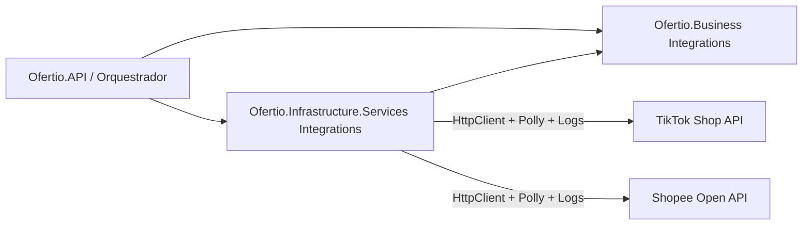

**Configuração:** seção `Integrations` em `appsettings.json` (hosts API/Orquestrador/Worker) — chaves de produção via variáveis de ambiente ou User Secrets, nunca commitadas.

### Fluxo OAuth2 (Fase 3.2)

```mermaid
sequenceDiagram
  participant Lojista
  participant API as Ofertio.API
  participant Auth as MarketplaceAuthService
  participant MP as TikTok/Shopee OAuth
  participant DB as MarketplaceTokens

  Lojista->>API: GET /api/marketplace-auth/{shopee|tiktok}/authorize-url
  API->>Auth: GenerateAuthorizationUrl (sandbox se PartnerId vazio)
  Auth-->>Lojista: authorizeUrl (200; Shopee nunca 500 por chave vazia)
  Lojista->>API: POST /api/marketplace-auth/vincular-manual (code_teste em homolog)
  API->>Auth: tokens sandbox sem chamada externa
  Auth-->>Lojista: IntegracaoLojaResponseDto 200
  MP-->>API: GET /callback?code=&shopId=
  API->>Auth: CallbackAndGenerateTokensAsync
  Auth->>MP: POST token/get (assinado)
  Auth->>DB: Upsert Access/Refresh (criptografado)
  API->>Auth: GetValidTokenAsync (refresh se expirado)
```

### Fluxo de catálogo — Sincronização de produtos (Fase 3.3)

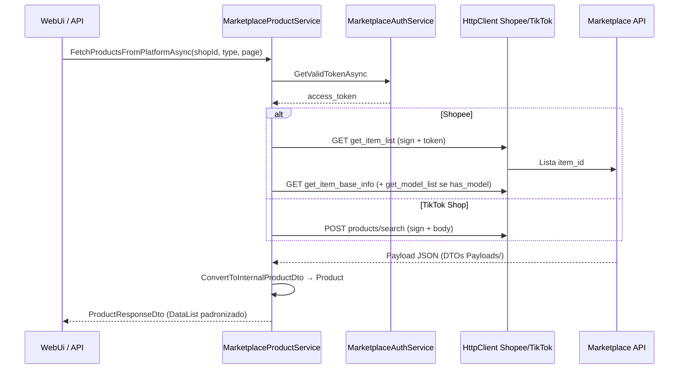

```
Ofertio.Business/Integrations/
├── Catalog/                     # IMarketplaceProductService
├── Shopee/Payloads/             # get_item_list, get_item_base_info, get_model_list
└── TikTokShop/Payloads/         # products/search

Ofertio.Infrastructure.Services/Integrations/Catalog/
├── MarketplaceProductService.cs
├── MarketplaceProductMapper.cs
└── MarketplaceProductRegistrationExtensions.cs
```

### Fluxo Pedidos & Estoque (Fase 3.4)

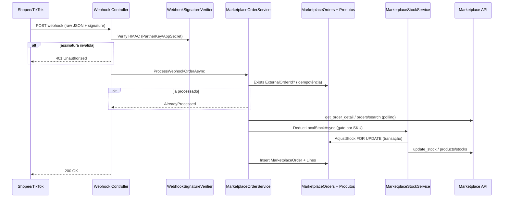

**Endpoints públicos (webhooks):**

| Método | Rota | Validação |
|--------|------|-----------|
| POST | `/api/webhooks/shopee` | Header `Authorization` = HMAC-SHA256(`WebhookCallbackUrl\|body`, PartnerKey) |
| POST | `/api/webhooks/tiktokshop` | Header `Webhook-Signature` ou `Tiktok-Signature` (HMAC com AppSecret/WebhookSecret) |

**Endpoints autenticados:**

| Método | Rota | Função |
|--------|------|--------|
| POST | `/api/marketplace-orders/poll` | Polling de contingência (`get_order_list` / `orders/search`) |
| PUT | `/api/Produtos/{id}` | Estoque local alterado → `UpdatePlatformStockAsync` se SKU vinculado |

**Concorrência:** `StockConcurrencyGate` serializa por `marketplace:shopId:sku`; `AdjustStockAsync` usa transação no PostgreSQL.

### Cobertura de testes automatizados (Ofertio.Tests)

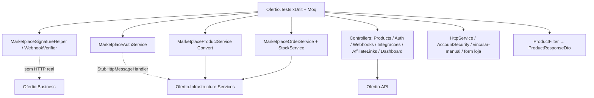

| Área Fase 3 | Classes de teste | Caminho feliz | Caminho triste |
|-------------|------------------|---------------|----------------|
| Assinatura HMAC | `MarketplaceSignatureHelperTests`, `MarketplaceWebhookSignatureVerifierTests` | assinatura válida | header ausente / expirado |
| OAuth | `MarketplaceAuthServiceTests` | URL + token válido + refresh | redirect vazio / token ausente |
| Catálogo | `MarketplaceProductServiceTests` | Shopee item/variante, TikTok SKU | `shopId` vazio |
| Pedidos | `MarketplaceOrderServiceTests` | webhook + baixa estoque | JSON inválido / idempotência |
| Estoque | `MarketplaceStockServiceTests` | dedução local | SKU não vinculado |
| API 3 objetos | `ProductsControllerResponseDtoTests`, `ProductFilterExtensionsTests` | `DataList` / NotFound | filtro sem match |
| Vincular loja HTTP | `HttpServiceVincularManualTests`, `AccountSecurityApiServiceTests`, `IntegracoesControllerTests` | envelope 200 / DTO camelCase | JSON inválido, campos invertidos/nulos sem 500 |
| Auth / Dashboard / Links | `AuthControllerSecurityTests`, `DashboardControllerTests`, `AffiliateLinksControllerTests` | JWT + `lojaId` | 401 sem usuário / 500 envelope |

---

## 📊 DIAGRAMA 1: ESTRUTURA FÍSICA ATUAL (fiel ao disco)

```
Tecso.AutomacaoCusor/
├── README.md                    # Painel principal (regras + Fases 32–34)
│   └── docs/HISTORICO_FASES_CONCLUIDAS.md  # Fases 1–31 concluídas
├── Ofertio.sln
├── .gitignore
├── docs/                        # Documentação (este arquivo, LISTA, ANALISE, …)
│
├── Ofertio.Core/
│   ├── Entities/                # 11 entidades de domínio (Campaign, Product, …)
│   ├── Enums/                   # MarketplaceType (Shopee, TikTokShop)
│   └── Exceptions/              # BaseCustomException, NotFound, Unauthorized, ExceptionMiddleware
│
├── Ofertio.Business/
│   ├── Dto/                     # *Dto, *ResponseDto, ResponseDto, Auth/
│   ├── Integrations/            # Contratos + Options + Auth (TikTokShop, Shopee)
│   │   ├── Auth/                # IMarketplaceAuthService, IMarketplaceSignatureService
│   │   ├── Common/              # MarketplaceSignatureHelper, HttpClient names
│   │   ├── TikTokShop/
│   │   └── Shopee/
│   ├── Enum/                    # (pasta reservada — vazia no momento)
│   ├── Interfaces/
│   │   ├── Repositories/        # I*Repository (7 contratos)
│   │   └── Services/            # I*Service, ITikTok*, IShopee*, helpers legados
│   ├── Pipelines/               # ColetaDados, GeracaoConteudo, Publicacao
│   └── Service/
│       ├── Application/         # *ApplicationService + AddOfertioApplicationServices()
│       ├── CryptographyHelper.cs
│       └── ValidationHelper.cs
│
├── Ofertio.Data/                # Migrations EF Core do SQL Server (`InitialSqlServerMigration`)
│
├── Ofertio.Database/
│   ├── AppDbContext.cs          # DbContext principal
│   ├── Entity/                  # UserEntity
│   ├── Filter/                  # *Filter + FilterQueryExtensions
│   ├── Interface/               # (vazia — contratos em Business.Interfaces)
│   ├── Pagin/                   # PagedResult, QueryableExtensions
│   ├── Prompts/                 # GeracaoDescricao, Roteiro, Titulo
│   └── Repositorio/             # AppDbContextFactory
│
├── Ofertio.Application/         # ⚠️ Residual
│   └── Controller/              # AuthController.cs (stub — não é controller HTTP)
│
├── Ofertio.Infrastructure/
│   ├── API/                     # Shopee/, TikTok/ (+ Models/)
│   ├── Configuration/           # AppConfiguration, SerilogLogger
│   ├── Data/                    # DataService, Configurations/ (sem AppDbContext)
│   ├── Interfaces/              # IAppConfiguration, IUserContextProvider, ILoggerService
│   ├── Migrations/              # EF migrations PostgreSQL (Homologacao)
│   ├── Security/                # JwtTokenService, UserContextProvider
│   └── Services/Security/       # LegacyCredentialReEncrypt*
│
├── Ofertio.Infrastructure.Services/
│   ├── Integrations/            # HttpClients, Polly, ExternalApiLoggingHandler — Fase 3.1+
│   ├── Repositories/            # 6 repositórios (Affiliate, Campaign, Content, …)
│   ├── Service/ExternalServices/ # Gemini, OpenAI, Shopee, TikTok*, Ranking, …
│   ├── Interfaces/              # ⚠️ fantasmas (vários Compile Remove no csproj)
│   ├── ServiceRegistrationExtensions.cs
│   ├── CoreServiceRegistrationExtensions.cs      # ⚠️ ainda separado
│   ├── ExternalServiceRegistrationExtensions.cs
│   ├── InfrastructureDataServiceRegistrationExtensions.cs
│   └── DatabaseUrlConfiguration.cs
│
├── Ofertio.API/
│   ├── Controllers/             # 11 controllers (+ WeatherForecast scaffold)
│   ├── Program.cs               # DI: Core + Infra + Data + Application (Business)
│   ├── Properties/
│   └── (sem Middleware/*.cs — ExceptionMiddleware só no Core)
│
├── Ofertio.Orquestrador/
│   ├── Controllers/             # Auth, Campaigns, Dashboard, Metrics, UserAccounts
│   ├── Extensions/              # DatabaseExtensions, DemoDataSeeder
│   ├── Interfaces/
│   ├── Pipelines/
│   ├── Program.cs               # DI alinhado à API
│   └── OrquestradorPrincipal.cs
│
├── Ofertio.SharedUi/            # RCL UI compartilhada (Fase 4.2) — AppRoutes.razor (MAUI)
├── Ofertio.WebUi/               # Host Blazor Server + OAuth (Fase 3/4) — Routes.razor único
├── Ofertio.Mobile/              # MAUI Blazor Hybrid (Fase 4.2) — TFM Windows `net9.0-windows*` (sem iOS/Mac Catalyst)
│   ├── Components/, Services/, Extensions/, Models/, wwwroot/, …
│   └── → Ofertio.Business (*ResponseDto, DashboardSummaryDto)
│
├── Ofertio.Worker/              # Program.cs, WorkerService.cs
├── Ofertio.Tests/               # Mock/, Integration/, Unit/, Services/, …
├── Ofertio.Util/                # Address/, Security/, Validation/
└── (externo na sln) ../Tecso.LerArquivos/
```

### Mapa de dependências entre projetos (referência de compilação)

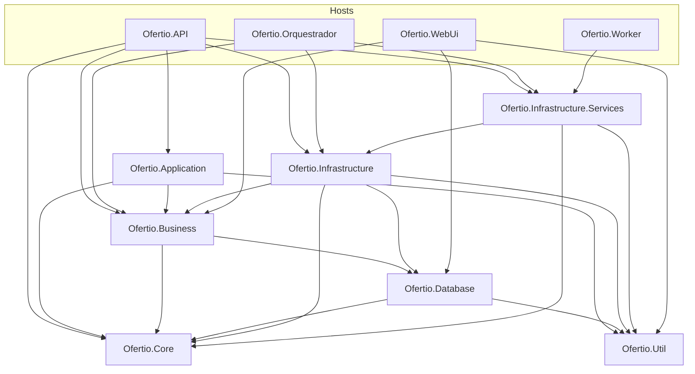

---

## 📊 DIAGRAMA 2: DIVERGÊNCIAS (diagrama × disco)

| Item no diagrama antigo | Situação real (jun/2026) |
|-------------------------|---------------------------|
| `Ofertio.Core/Interfaces/` | **Removido** — contratos em `Ofertio.Business/Interfaces/` |
| `Ofertio.Core/Dto`, `Prompts` | **Movidos** — Dtos em Business; Prompts em Database |
| `Ofertio.Application/Services/*` | **Movidos** — `Ofertio.Business/Service/Application/` |
| `Infrastructure/Data/AppDbContext` | **Movido** — `Ofertio.Database/AppDbContext.cs` |
| `API/Middleware/ExceptionMiddleware` | **Removido da API** — único em `Core/Exceptions/` |
| `Orquestrador` "Hello World" | **Obsoleto** — `Program.cs` completo com DI |
| `Ofertio.Portal` / `Ofertio.Dashboard` | **Removidos** — UI canônica em `Ofertio.WebUi` |
| 4 arquivos `*RegistrationExtensions` | **Ainda separados** — consolidação pendente |
| `Infrastructure.Services/Interfaces/*.cs` | **Fantasmas** — excluídos do compile, ainda no disco |

---

## 🔄 DIAGRAMA 3: FLUXO DE DEPENDENCY INJECTION (jun/2026)

```
┌─────────────────────────────────────────────────────────────────┐
│ Ofertio.API / Ofertio.Orquestrador (mesmo padrão de DI)           │
└─────────────────────────────────────────────────────────────────┘
                              │
    ┌─────────────────────────────────────────────────────────────┐
    │ Program.cs                                                   │
    │ ✓ AddOfertioCoreServices()                                   │
    │ ✓ AddOfertioInfrastructureServices(config)                     │
    │ ✓ AddOfertioInfrastructureData(config)  → DbContext + repos  │
    │ ✓ AddOfertioApplicationServices()       → Ofertio.Business   │
    │ ✓ JWT (API) + Serilog + Controllers                        │
    │ ✓ UseMiddleware<ExceptionHandlingMiddleware>() → ProblemDetails   │
    └─────────────────────────────────────────────────────────────┘
                              │
         ┌────────────────────┼────────────────────┐
         ▼                    ▼                    ▼
   Controllers          Business.AppServices    Infra.Services
   (Filter/Dto/         (Campaigns, Products,   (Repositories,
    ResponseDto)         Metrics, AI, …)          External APIs)
```

**Pendências de DI (ver LISTA):** consolidar 4 `*RegistrationExtensions` em um arquivo; remover interfaces fantasma em `Infrastructure.Services/Interfaces/`.

---

## ✅ DIAGRAMA 4: ALVOS ARQUITETURAIS (ainda não 100% no disco)

```
┌─────────────────────────────────────────────────────────────────┐
│            EXTENSION METHODS (COMPARTILHADO)                    │
├─────────────────────────────────────────────────────────────────┤
│                                                                  │
│ Ofertio.Infrastructure.Services/                                 │
│   ServiceRegistrationExtensions.cs (ÚNICO)                      │
│   └─ AddOfertioInfrastructureServices(config) ✓✓                │
│      ├─ DbContext                                               │
│      ├─ 6 Repositories                                          │
│      ├─ 4 Business Services                                     │
│      └─ 5 External API HttpClients                              │
│                                                                  │
│ Ofertio.Business/Service/Application/                             │
│   ApplicationServiceCollectionExtensions.cs                     │
│   └─ AddOfertioApplicationServices() ✓ (já em uso na API/Orq)    │
│      └─ 9 ApplicationServices                                   │
│                                                                  │
│ Ofertio.API/                                                      │
│   Authentication/ServiceRegistrationExtensions.cs               │
│   └─ AddOfertioAuthentication(config) ✓✓                         │
│      ├─ JWT                                                     │
│      └─ IUserContextProvider                                    │
│                                                                  │
└─────────────────────────────────────────────────────────────────┘
     △                          △                        △
     │                          │                        │
     └──────────┬───────────────┼────────────┬──────────┘
                │               │            │
    ┌───────────┴────────┐      │   ┌────────┴──────────┐
    ▼                    ▼      ▼   ▼                   ▼
┌──────────────────┐  ┌──────────────────────────┐  ┌─────────────────┐
│  Ofertio.API       │  │  Ofertio.ORQUESTRADOR      │  │ Ofertio.DASHBOARD │
│                  │  │                          │  │ (se precisar)   │
│ Program.cs:      │  │ Program.cs: ✓✓           │  │                 │
│ ✓ AddOfertioInfra  │  │ await Configurator       │  │ Program.cs:     │
│ ✓ AddOfertioAppSvcs│  │   .ConfigureAndRunAsync()│  │ ✓ AddOfertioInfra │
│ ✓ AddOfertioAuth   │  │                          │  │ ✓ AddOfertioAppSvcs
│                  │  │ Configurator.cs:         │  │ ✓ AddOfertioAuth  │
│ Controllers      │  │ ✓ AddOfertioInfra          │  │                 │
│ (Endpoints HTTP) │  │ ✓ AddOfertioAppSvcs        │  │ Controllers/    │
│                  │  │ ✓ AddOfertioAuth           │  │ Views/Pages     │
│                  │  │                          │  │                 │
└──────────────────┘  │ OrquestradorService ✓✓  │  └─────────────────┘
                      │ (Lógica pura)           │
                      │                          │
                      │ Pipelines                │
                      │ (ColetaDados, Conteúdo) │
                      └──────────────────────────┘

✓✓ TODOS USAM OS MESMOS EXTENSION METHODS!
✓✓ SINCRONIZADOS AUTOMATICAMENTE!
✓✓ FÁCIL ADICIONAR NOVOS SERVIÇOS!
```

---

## 📂 DIAGRAMA 5: ESTRUTURA DE INTERFACES (físico — jun/2026)

### Canônico (em uso)
```
Ofertio.Business/Interfaces/
├── Repositories/
│   ├── IRepository.cs
│   ├── IAffiliateRepository.cs
│   ├── ICampaignRepository.cs
│   ├── IContentRepository.cs
│   ├── IMetricRepository.cs
│   ├── IProductRepository.cs
│   ├── IUserAccountRepository.cs
│   └── IAIProvider.cs, IOrquestradorRepository.cs
│
└── Services/
    ├── IAIService, IGeminiService, IDataService, …
    ├── IShopeeApi, ITikTokShopApi, ITikTokAdsApiService
    └── AnaliseService.cs, ProdutoService.cs, UsuarioService.cs  # ⚠️ impl. com nome de serviço

Ofertio.Infrastructure/Interfaces/
├── IAppConfiguration.cs
├── IUserContextProvider.cs
└── ILoggerService.cs
```

### Legado no disco (limpar)
```
Ofertio.Infrastructure.Services/Interfaces/
├── IShopeeApi.cs, ITikTokShopApi.cs, ITikTokAdsApiService.cs  # Compile Remove
└── ITikTokShopApiService.cs  # namespace Ofertio.Core.Interfaces.Services
```

---

## 🗺️ DIAGRAMA 6: MAPA DE DEPENDÊNCIAS — REPOSITÓRIOS (jun/2026)

```
┌──────────────────────────────────────────────────────────────┐
│ CONTRATOS (Ofertio.Business.Interfaces.Repositories)          │
├──────────────────────────────────────────────────────────────┤
│ IRepository ◄─── BaseEntity (Core)                           │
│ IAffiliateRepository, ICampaignRepository, IContentRepository │
│ IMetricRepository, IProductRepository, IUserAccountRepository │
│ IOrquestradorRepository, IAIProvider                         │
└──────────────────────────────────────────────────────────────┘
                           △
                           │
        ┌──────────────────┴──────────────────┐
        │                                     │
┌───────┴──────────────────┐        ┌────────┴──────────────┐
│ IMPLEMENTAÇÕES           │        │ ONDE REGISTRADOS      │
│ (Infra.Services/         │        │ (API/Prog ou Orq)     │
│  Repositories)           │        │                       │
├──────────────────────────┤        ├──────────────────────┤
│ AffiliateRepository      │────────│ AddOfertioInfrastructureData │
│ CampaignRepository       │────────│ (API + Orquestrador)         │
│ ContentRepository        │────────│                              │
│ MetricRepository         │────────│                              │
│ ProductRepository        │────────│                              │
│ UserAccountRepository    │────────│                              │
└──────────────────────────┘        └──────────────────────┘


┌──────────────────────────────────────────────────────────────┐
│ SERVICES (Ofertio.Business.Interfaces.Services)               │
├──────────────────────────────────────────────────────────────┤
│ Contratos ──► Implementações (Infrastructure.Services)       │
│   IAIService ──► OpenAIService                               │
│   IGeminiService ──► GeminiService                             │
│   IShopeeApi / ITikTokShopApi / ITikTokAdsApiService         │
│   IScoreService, IRankingService, …                          │
│                                                              │
│ Application (Ofertio.Business/Service/Application/)          │
│   AddOfertioApplicationServices() ✓ chamado na API e Orq     │
└──────────────────────────────────────────────────────────────┘


┌──────────────────────────────────────────────────────────────┐
│ REGISTRATION (⚠️ ainda 4 arquivos + 1 em Business)           │
├──────────────────────────────────────────────────────────────┤
│ Infrastructure.Services: ServiceRegistrationExtensions,      │
│   Core*, External*, InfrastructureData*                      │
│ Business: ApplicationServiceCollectionExtensions ✓           │
└──────────────────────────────────────────────────────────────┘
```

---

## 🗺️ DIAGRAMA 7: ALVO DE DEPENDÊNCIAS (parcialmente implementado)

> **Nota:** Bloco abaixo descreve o estado **desejado**. Contratos já estão em `Ofertio.Business`; consolidação de DI e remoção de `Infrastructure.Services/Interfaces/` ainda pendente.

```
┌──────────────────────────────────────────────────────────────┐
│ INTERFACES (alvo: Ofertio.Business — hoje já é o canônico)   │
├──────────────────────────────────────────────────────────────┤
│ Interfaces/Repositories/ (9)                                 │
│ Interfaces/Services/Business/ (8)                            │
│ Interfaces/Services/ExternalApis/ (4) ← MOVIDAS               │
│ Interfaces/Infrastructure/ (3)                               │
└──────────────────────────────────────────────────────────────┘
                           △
                           │
        ┌──────────────────┴──────────────────┐
        │                                     │
┌───────┴──────────────────┐        ┌────────┴──────────────┐
│ IMPLEMENTAÇÕES           │        │ EXTENSÕES           │
│ (Infra.Services,         │        │ (Extension Methods)  │
│  Infra/Data,             │        │                      │
│  Application)            │        ├──────────────────────┤
├──────────────────────────┤        │ Ofertio.Infrastructure │
│ AfiliadoRepository       │────┐   │ .Services            │
│ CampanhaRepository       │────┤   │ ServiceRegExtensions │
│ ... (6 repos total)      │    │   │ └─ AddOfertioInfra  ✓✓ │
│                          │    │   │                      │
│ DataService              │    │   │ Ofertio.Business       │
│ OpenAIService            │────┼───│ Service/Application  │
│ GeminiService            │    │   │ └─ AddOfertioAppSvcs ✓ │
│ ShopeeApiService         │    │   │                      │
│ TikTokAdsApiService      │    │   │                      │
│ TikTokShopApiService     │    │   │ Ofertio.API            │
│ RankingService           │    │   │ Authentication       │
│ ScoreService             │    │   │ ServiceRegExtensions │
│ ... (11+ total)          │    │   │ └─ AddOfertioAuth   ✓✓ │
│                          │    │   │                      │
│ 11 ApplicationServices ──┼────┘   └──────────────────────┘
│ (sem duplicatas)         │
│                          │
└──────────────────────────┘
         │
         │
    ┌────┴────────────────────────┐
    │ USADOS EM TODOS OS PROJETOS │
    ├────────────────────────────┤
    │ Ofertio.API                   │
    │ Ofertio.Orquestrador          │
    │ Ofertio.WebUi                 │
    │ Ofertio.Worker (se usar)      │
    └────────────────────────────┘

✓✓ ÚNICA FONTE DE VERDADE
✓✓ FÁCIL SINCRONIZAR
✓✓ SEM DUPLICATAS
```

---

## 🔄 DIAGRAMA 8: CICLO DE IMPLEMENTAÇÃO

```
┌─────────────────┐
│   START         │
└────────┬────────┘
         │
         ▼
┌─────────────────────────────────────┐
│ FASE 1: Consolidar Registration    │
│ (1 hora - 4 arquivos → 1 arquivo) │
└────────┬────────────────────────────┘
         │
         ▼
┌─────────────────────────────────────┐
│ FASE 2: Mover Arquivos             │
│ (1.5 horas - reorganizar)          │
│ ✓ Interfaces para Core             │
│ ✓ Impls fora de Interfaces         │
│ ✓ Arquivos soltos organizados      │
└────────┬────────────────────────────┘
         │
         ▼
┌─────────────────────────────────────┐
│ FASE 3: Criar Novos Arquivos       │
│ (1 hora - novos extension methods) │
└────────┬────────────────────────────┘
         │
         ▼
┌─────────────────────────────────────┐
│ FASE 4: Editar Existentes          │
│ (1.5 horas - Program.cs, etc.)    │
└────────┬────────────────────────────┘
         │
         ▼
┌─────────────────────────────────────┐
│ FASE 5: Testes e Validação        │
│ (1 hora - compile, run, test)     │
└────────┬────────────────────────────┘
         │
         ▼
┌─────────────────┐
│ ✅ COMPLETE    │
│ 4-6 horas      │
└─────────────────┘
```

---

## 📋 LEGENDA

| Símbolo | Significado |
|---------|------------|
| ✓ | Correto, sem problemas |
| ✓✓ | Muito bom, recomendado |
| ✓✓✓ | Otimizado, excelente |
| ⚠️ | Atenção, possível problema |
| ❌ | Erro, crítico |
| 🟢 | Status OK |
| 🟡 | Status em desenvolvimento/incompleto |
| 🔴 | Status crítico |
| △ | Fluxo ascendente |
| ▼ | Fluxo descendente |

---

## 🔔 DIAGRAMA 4d: Push + Deep Links (Fase 4.3)

```
Mobile App                          Ofertio.API
──────────                          ──────────
FCM/APNs token ──POST──► /api/devices/register ──► UserDeviceTokens (DB)
                              ▲
Worker/Webhook event ──► NotificationHubService (Firebase Admin)
                              │
                              └──► FCM data: { route, title, body }
                                        │
Mobile: OfertioFirebaseMessagingService / iOS UNCenter
        └──► PushNotificationBridge ──► NavigationIntentService
                    └──► Blazor: /engajamento/fila | /conciliacao/detalhes/{id}

Deep link: ofertio://engajamento/fila
           ofertio://conciliacao/detalhes/42
```

---

## 📱 DIAGRAMA 4c: Multiplataforma WebUi + MAUI (Fase 4.2)

```
┌─────────────────────┐     ┌─────────────────────┐
│   Ofertio.WebUi     │     │   Ofertio.Mobile    │
│ Blazor Server host  │     │ MAUI BlazorWebView  │
│ OAuth + cookies     │     │ sessão em memória   │
└──────────┬──────────┘     └──────────┬──────────┘
           │  AddAdditionalAssemblies   │  Root: Routes (RCL)
           └────────────┬───────────────┘
                        ▼
           ┌────────────────────────────┐
           │     Ofertio.SharedUi       │
           │  Pages · Layout · Widgets  │
           │  AddOfertioClientServices  │
           │  (SSL bypass dev/homolog)  │
           └────────────┬───────────────┘
                        │ HttpClient "Orquestrador"
                        │ Development/Homologacao: ignora cert. autoassinado
                        ▼
           ┌────────────────────────────┐
           │ Ofertio.Orquestrador / API │
           └────────────────────────────┘
```

---

## 📱 DIAGRAMA 4b: WebUi Mobile-First (Fase 4.1)

```
┌─────────────────────────────────────────────────────────────────────────┐
│ viewport < 768px                                                         │
│  MainLayout: [☰] Ofertio ── SessionBadge                                 │
│  sidebar off-canvas (transform) + backdrop tap-to-close                  │
│  CampaignsWidget / MetricsWidget: .data-cards-mobile (stack)           │
│  breakpoint ≥ 768px: .data-table-desktop (tabela)                        │
│  botões/filtros: min-height 44px (.btn-touch)                            │
└─────────────────────────────────────────────────────────────────────────┘
```

| Breakpoint | Comportamento |
|------------|----------------|
| &lt; 768px | Tabelas ocultas; cards empilhados; menu lateral off-canvas |
| ≥ 768px | Tabelas visíveis; sidebar fixa (≥ 992px) |
| Filtros GET | `Page`, `PageSize` (máx. 30) → `PagingInfoDto` em `*ResponseDto` |

---

## 🖥️ DIAGRAMA 4: FLUXO WebUi — Filter / Dto / ResponseDto (Fase 3)

```
┌──────────────────────────────────────────────────────────────────────────┐
│ Ofertio.WebUi (Blazor Server)                                            │
│  CampaignFilterForm ──bind──► CampaignFilter                             │
│  MetricFilterForm   ──bind──► MetricFilter                               │
│  CampaignCreateForm ──bind──► CampaignDto                                  │
│  Dashboard.razor → IDashboardApiService → HttpService + query string    │
└───────────────────────────────┬──────────────────────────────────────────┘
                                │ HTTP + Bearer
                                ▼
┌──────────────────────────────────────────────────────────────────────────┐
│ Ofertio.Orquestrador / Ofertio.API                                       │
│  GET  api/Campanhas?[CampaignFilter&Page&PageSize] → CampaignResponseDto │
│       + PagingInfoDto (TotalCount, HasNextPage)                          │
│  GET  api/Metricas?[MetricFilter&Page&PageSize]    → MetricResponseDto   │
│  POST api/Campanhas (CampaignDto)     → CampaignResponseDto              │
│  POST api/Metricas  (MetricDto)       → MetricResponseDto                │
└───────────────────────────────┬──────────────────────────────────────────┘
                                │
                                ▼
┌──────────────────────────────────────────────────────────────────────────┐
│ Widgets leem ResponseDto.DataList (Campaign, Metric) + Status/Descricao   │
└──────────────────────────────────────────────────────────────────────────┘
```

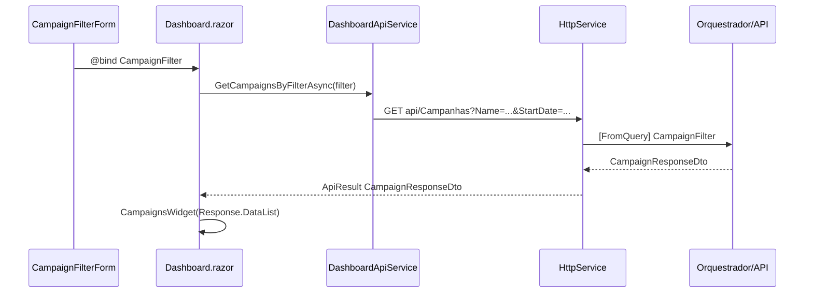

---

## 🚀 DIAGRAMA 5: Afiliados — Engajamento, Comissões e Links (Fase 5)

Visão macro do fluxo de dados da plataforma de automação para afiliados de alta escala. Contratos em `Ofertio.Business/Interfaces/Orchestration/`; persistência de `AffiliateLink` e filas entram na Fase 6.

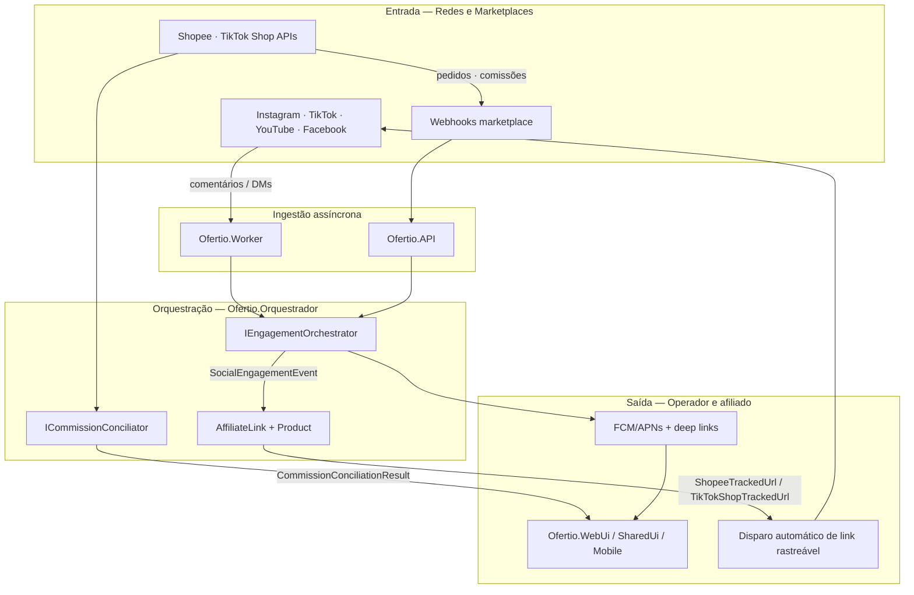

| Camada | Artefatos principais |
|--------|----------------------|
| `Ofertio.Core/Enums` | `SocialMediaType`, `EngagementStatus`, `CommissionStatus`, `MarketplaceType` |
| `Ofertio.Core/Entities` | `AffiliateLink`, `Product`, `MarketplaceOrder`, `Conversion` |
| `Ofertio.Business/Domain` | `Engagement/*`, `Commission/*` |
| `Ofertio.Business/Interfaces/Orchestration` | `IEngagementOrchestrator`, `ICommissionConciliator` |

```
Redes Sociais / Marketplaces
        │
        ▼
Webhooks (API) ──────────────┐
Worker (polling / filas*)    ├──► Orquestrador
        │                    │         ├── IEngagementOrchestrator → link afiliado
        │                    │         └── ICommissionConciliator → auditoria comissões
        ▼                    │
MarketplaceTokens / Orders   │
        │                    ▼
        └────────────► WebUi · Mobile (fila engajamento, painel conciliação)

* filas RabbitMQ — **implementado (Fase 6.1)**
```

---

## 📡 DIAGRAMA 6.4: Observabilidade (OpenTelemetry + Painel de saúde)

```mermaid
flowchart TB
  subgraph Hosts
    API[Ofertio.API]
    WRK[Ofertio.Worker]
    ORQ[Ofertio.Orquestrador]
  end

  subgraph OTel[Ofertio.Observability]
    TR[Traces AspNetCore + HttpClient]
    MT[Metrics comentarios / links / conciliacao]
    LG[Logs OTLP + Console]
  end

  subgraph Export
    PROM[/metrics Prometheus]
    OTLP[OTLP Collector / Seq]
    IISLOG[IIS stdout .\logs\stdout]
    FILELOG[Serilog logs/app-.txt]
  end

  UI[PainelSaude.razor] --> ORQ
  ORQ --> HealthAPI[GET /api/saude/dashboard]

  API --> OTel
  WRK --> OTel
  ORQ --> OTel
  API --> IISLOG
  API --> FILELOG
  OTel --> PROM
  OTel --> OTLP
```

| Destino de log (Fase 14) | Host | Configuração |
|--------------------------|------|--------------|
| IIS stdout | API / WebUi | `web.config` → `stdoutLogEnabled`, `.\logs\stdout` |
| Serilog arquivo | API / WebUi | `Program.cs` → `logs/app-.txt` (rolagem diária) |
| Circuitos Blazor | WebUi | `BlazorCircuitLoggingHandler` (SignalR open/close/reconnect) |
| Permissões IIS | `C:\inetpub\ofertio\*\logs` | `Configurar-Logs-IIS.ps1` |

| Métrica | Origem |
|---------|--------|
| `comentarios_processados_total` | `SocialMediaCommentConsumer` |
| `links_enviados_sucesso` | Triagem positiva + entrega simulada |
| `erros_conciliacao_contagem` | Falhas em relatórios marketplace |

---

## 📦 DIAGRAMA 6.3: Catálogo global de propaganda e links

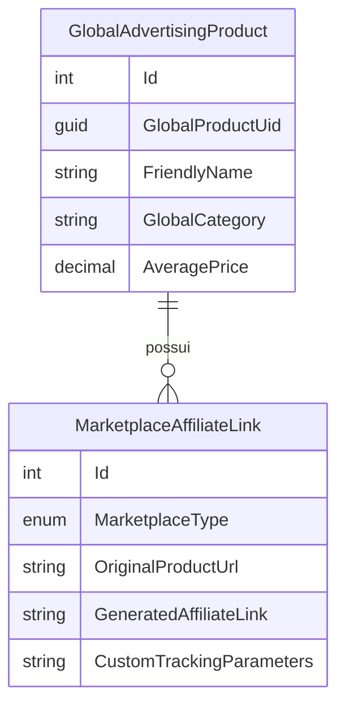

```
ProdutosPropaganda.razor (WebUi/SharedUi)
        │ POST/GET api/propaganda/produtos
        ▼
AdvertisingProductService
        ├── CreateGlobalProductAsync → DB ProdutosPropagandaGlobal
        ├── gera links Shopee/TikTok (sub_id / campaign)
        └── GenerateOptimizedPayloadForPostAsync → robô engajamento (6.1)
```

| Entidade legada | Nova modelagem 6.3 |
|-----------------|-------------------|
| `Product` (estoque) | `GlobalAdvertisingProduct` (divulgação) |
| `AffiliateLink` (conceitual) | `MarketplaceAffiliateLink` (persistido) |

---

## 💰 DIAGRAMA 6.2: Conciliação financeira de afiliado

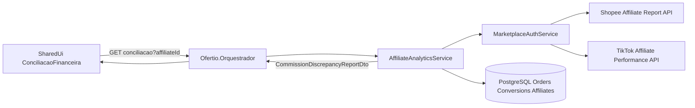

| DTO | Uso |
|-----|-----|
| `AffiliatePerformanceDto` | KPIs no topo do painel |
| `CommissionDiscrepancyReportDto` | Tabela/cards de divergências |
| `AffiliateReconciliationResponseDto` | Envelope API + `PagingInfoDto` |

---

## 📨 DIAGRAMA 6.1: Mensageria — Comentários e Triagem (RabbitMQ + MassTransit)

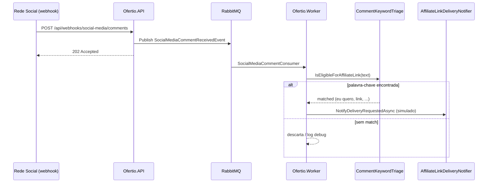

| Componente | Fila / política |
|------------|-----------------|
| Fila principal | `social-media-comment-received` |
| DLQ (erro após retries) | `social-media-comment-received-error` |
| Retry | `RetryCount` × intervalo (`RetryIntervalSeconds`) |
| Publicador | API, Orquestrador (`OfertioMessagingRole.Publisher`) |
| Consumidor | Worker (`OfertioMessagingRole.Consumer`) |

```
Instagram/TikTok/... webhook
        │
        ▼
Ofertio.API ──publish──► RabbitMQ ──consume──► Ofertio.Worker
                              │                      │
                              │                      ├── triagem Keywords (appsettings)
                              │                      └── link simulado por PostId
                              └──► DLQ (falha persistente)
```

---

## 📦 DIAGRAMA 7.3: Transação de Estoque Físico (Reserva → Débito → Kardex)

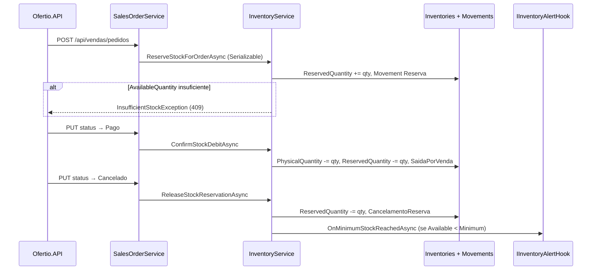

| Método | Quando | Efeito |
|--------|--------|--------|
| `ReserveStockForOrderAsync` | Pedido **Pendente** criado | Bloqueia unidades (anti-overbooking) |
| `ConfirmStockDebitAsync` | **Pago** ou faturamento | Baixa física + zera reserva do pedido |
| `ReleaseStockReservationAsync` | **Cancelado** | Devolve reserva ao disponível |

---

## 🛒 DIAGRAMA 7.2: Ciclo de Vida do Pedido de Venda (ERP Local)

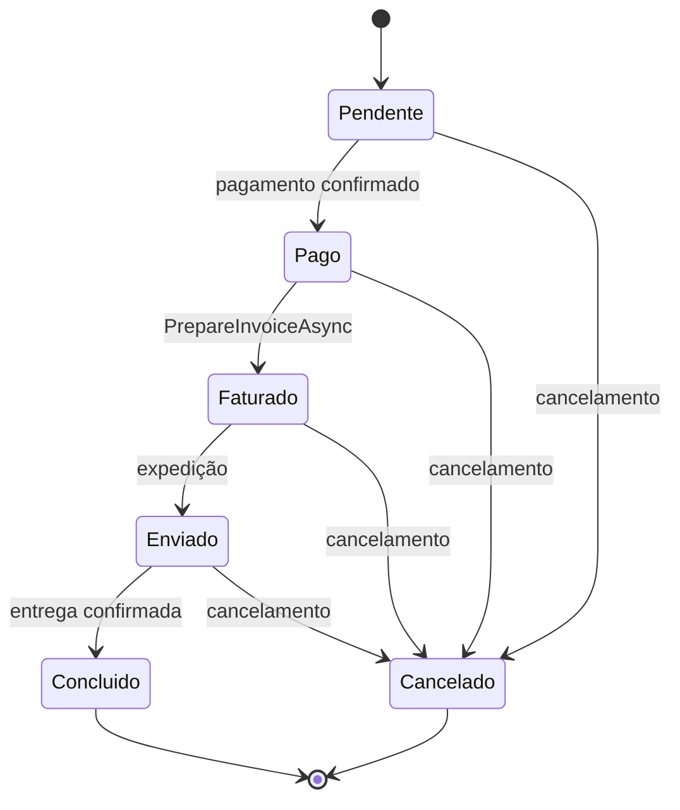

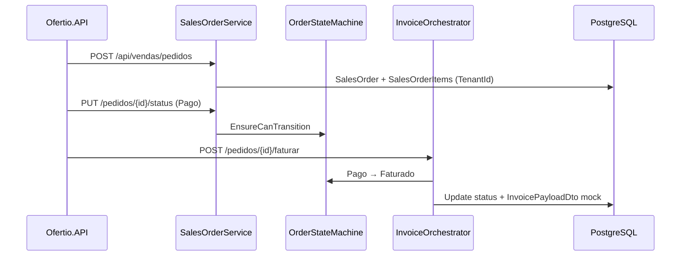

| Entidade | Tabela | Isolamento |
|----------|--------|------------|
| Customer | `Customers` | `TenantId` |
| SalesOrder (Order) | `SalesOrders` | `TenantId` + `ShopId` opcional |
| SalesOrderItem | `SalesOrderItems` | `TenantId` |

**API:** `api/vendas/clientes`, `api/vendas/pedidos`, `POST .../faturar` → gancho NF-e (`InvoicePayloadDto`).

---

## 🏢 DIAGRAMA 7.1: Multi-Tenant / Multi-Conta Marketplace (SaaS Ready)

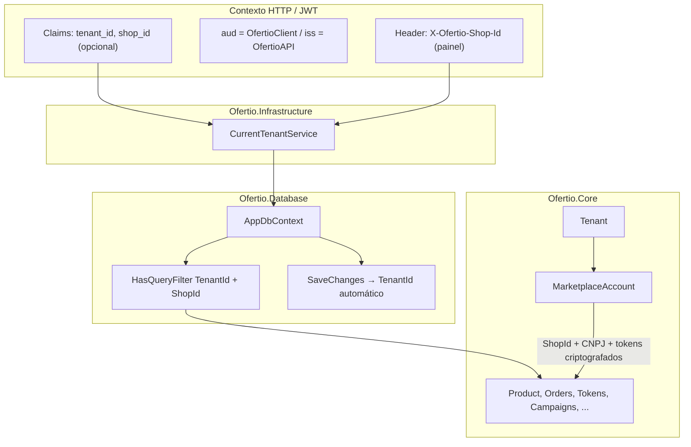

| Camada | Artefato | Função |
|--------|----------|--------|
| Core | `Tenant`, `MarketplaceAccount`, `ITenantScopedEntity` | Modelo SaaS e vínculo multi-loja |
| Database | `ICurrentTenantService`, `AppDbContext` (filtro de instância) | Isolamento por tenant/loja; login sem JWT não oculta `Usuarios` |
| Infrastructure | `CurrentTenantService` | Extrai `tenant_id` / `shop_id` do JWT ou header |
| Repositories | `ListConsolidated*` / `ListForShop*` | Visão agregada vs. loja única no painel |
| Migração | `AddMultiTenantArchitecture` | Tabelas `Tenants`, `MarketplaceAccounts`, colunas `TenantId` |

```
Request autenticado
    → CurrentTenantService (TenantId + ShopId opcional)
    → AppDbContext query filter (isolamento automático)
    → Repositório: consolidado (ShopId null) OU ForShop(shopId)

Request sem JWT (login e-mail/senha)
    → filtro usa membros do AppDbContext da requisição (TenantId null = sem restrição)
    → GetByEmail (IgnoreQueryFilters) localiza Usuarios e CheckPassword valida o hash
```

```mermaid
sequenceDiagram
  participant UI as ConnectStoreModal (InteractiveServer)
  participant API as MarketplaceAuthController
  participant SVC as IntegracaoLojaService
  participant DB as MarketplaceAccounts
  UI->>UI: "Como pegar meu ID?" (HowToGetStoreIdModal: Computador / Telemóvel)
  UI->>UI: Detect plataforma pelo domínio (vt.tiktok / onelink / meli.la / shp.ee)
  UI->>UI: ExtractAffiliateIdFromUrl / TryExtractMercadoLivreTrackingId (dígitos ou matt_tool=)
  UI->>API: POST expand-affiliate-url (s.shopee.com.br / br.shp.ee / shope.ee / vt.tiktok.com / magazineluiza.onelink.me / meli.la /sec/)
  SVC->>SVC: UrlUnshortenerService + UrlExpansion; unique_id TikTok / promoter_id Magalu / matt_tool ML
  SVC->>DB: UNIQUE MarketplaceType+TrackingId (IsActive)
  UI->>API: POST /api/marketplace-auth/lojas/{id}/desconectar
  API->>SVC: UnlinkAsync → InativarContaAsync (AppDbContext SaveChanges IsActive=false)
  UI->>UI: VincularManualmenteDirect (type=button)
  UI->>UI: lê apelido + Affiliate ID; Shopee e TikTok Shop sem OAuth (Universal Link)
  UI->>UI: SyncSessionFromPrincipal (JWT do cookie)
  UI->>API: POST /api/marketplace-auth/vincular-manual (Authorization Bearer; fallback UserId=1 no IIS)
  API->>SVC: LinkAsync (pula OAuth Shopee se Dev/Homologação ou code_*)
  SVC->>DB: SELECT MarketplaceAccounts (colunas TrackingId/ShopId/AppKey/AppSecret anuláveis)
  SVC->>SVC: MarketplaceAccountMapper (NULL → string.Empty)
  alt SQL/exceção
    API-->>UI: HTTP 500 JSON ResponseDto.Fail("Erro do Servidor/SQL: ...")
  else corpo vazio / HttpRequestException
    UI-->>UI: alerta "Erro de Conexão no IIS (HTTP {status}): porta 5001 / CORS"
  else HTML/IIS
    UI-->>UI: alerta "Erro retornado pelo IIS: " + 200 chars
  else sucesso
    SVC-->>UI: MarketplaceAccountResponseDto.Ok()
  end
```

---

## Backoffice Master SaaS (Fases 35 a 41)

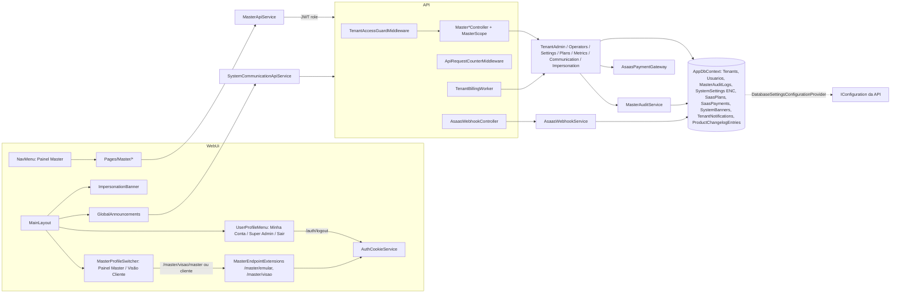

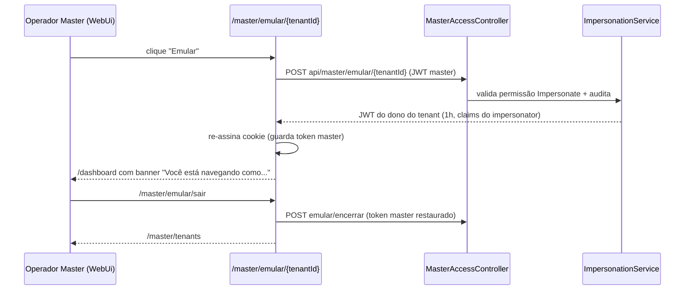

---

## Rotas Master, contas de desenvolvedor e menu por plano (Fases 42 a 44)

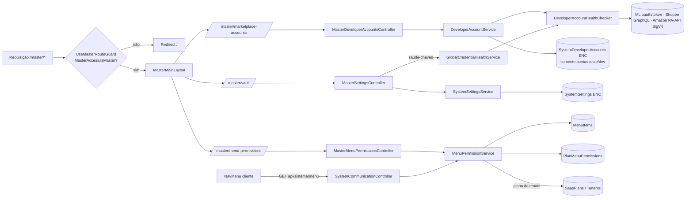

---

## Navegação, hierarquia da sidebar e paletas Master × Cliente (Fase 45)

```mermaid
flowchart TB
  subgraph Layouts["Layouts estáticos (SSR)"]
    CL[MainLayout<br/>.portal-shell · paleta clara]
    MML[MasterMainLayout<br/>data-bs-theme=dark · slate + #FF9900]
  end
  CL --> NSR[NavigationScrollReset<br/>ilha interativa]
  MML --> NSR
  NSR -->|LocationChanged| JS[ofertioAppInterop.resetScroll<br/>window + .main-content]
  BW[blazor.web.js enhancedload] --> JS
  CL --> NAV[NavMenu]
  NAV -->|GET api/sistema/menu| MPS[MenuPermissionService]
  MPS -->|EnsureCatalogAsync sincroniza pai/ordem/título| MI[(MenuItems)]
  CAT[DefaultMenuCatalog] --> MPS
  NAV --> R1[Categoria · cabeçalho caixa alta]
  R1 --> R2[Menu pai · ícone destacado + negrito]
  R2 --> R3[Submenu · recuo 1.5rem + linha guia]
```

---

## Drag & drop da árvore de menus e sidebar dirigida pelo banco (Fase 46)

```mermaid
sequenceDiagram
  participant M as Master (MasterMenuPermissions.razor)
  participant JS as ofertioMenuDnd (app-interop.js)
  participant API as MasterMenuPermissionsController
  participant S as MenuPermissionService
  participant DB as MenuItems / PlanMenuPermissions
  participant C as NavMenu (cliente)
  M->>JS: dragover → zona antes / dentro / depois
  M->>JS: drop → zone()
  alt borda superior/inferior
    M->>API: POST mover (before/after)
    API->>S: MoveAsync → OrderIndex dos irmãos
  else centro de uma pasta
    M->>API: POST mover (into)
    API->>S: MoveAsync → ParentId = pasta
  else centro de um item
    M->>M: modal "Nova pasta"
    M->>API: POST pastas
    API->>S: CreateFolderAsync → pasta.{id} + 2 filhos
  end
  S->>DB: SaveChanges (IsCustomized = true)
  S->>S: invalida cache da sidebar
  C->>API: GET api/sistema/menu[?visao=cliente] (a cada navegação)
  API->>S: GetClientMenuAsync(plano)
  S->>DB: árvore + ocultos do plano
```

---

## Busca do Mercado Livre: token de aplicação e fallback de vitrine (`MLBSearchOAuthFallback`)

```mermaid
flowchart TB
  BG[BuscaGlobal.razor /busca] --> OCS[OfficialCatalogSearchService]
  OCS --> MLS[MercadoLivreApiService]
  MLS --> UT{Token OAuth da loja?}
  UT -->|sim / refresh_token| API[api.mercadolibre.com/sites/MLB/search<br/>Authorization: Bearer]
  UT -->|não| VAULT[(Vault: Integrations:MercadoLivre:AppId/SecretKey<br/>IOptionsMonitor)]
  VAULT --> TOK[POST oauth/token<br/>grant_type=client_credentials<br/>cache do app token]
  TOK --> API
  API -->|200| ITEMS[Ofertas + matt_tool]
  API -->|401/403/escopo| LISTA[lista.mercadolivre.com.br/query<br/>MercadoLivreHtmlParser]
  TOK -->|sem credenciais| LISTA
  LISTA -->|cards| ITEMS
  LISTA -->|account-verification| ERR[Badge ❌ / ⚠️]
  ITEMS --> OCS
  OCS -->|CountVisibleOffers| BADGE[Badge 🟢 N produtos]
```

### Token OAuth da conta do tenant com renovação em 401/403 (`MLBOAuthSearchTokenFix`)

```mermaid
sequenceDiagram
  participant S as MercadoLivreApiService
  participant DB as Usuarios / MarketplaceAccounts
  participant V as Vault (AppId/SecretKey)
  participant ML as api.mercadolibre.com
  S->>DB: TenantId do usuário → conta ML ativa do tenant
  S->>S: log [ML Busca] conta '@Achadinhos de Aaz'
  S->>ML: GET sites/MLB/search (Authorization: Bearer da conta)
  alt 200
    ML-->>S: ofertas + matt_tool
  else 401/403
    S->>V: AppId / SecretKey
    S->>ML: POST oauth/token (grant_type=refresh_token)
    S->>DB: grava AccessToken / RefreshToken / ExpiresAt
    S->>ML: repete a busca com o novo Bearer
    ML-->>S: ofertas (ou vitrine lista.mercadolivre.com.br se recusar de novo)
  end
```

### Busca ML só pela API oficial (`MercadoLivreSearchOAuthOnly`, substitui `MLBScraperPrimary`)

```mermaid
flowchart TB
  BG[BuscaGlobal.razor /busca] --> OCS[OfficialCatalogSearchService]
  OCS --> MLS[MercadoLivreApiService.SearchProductsAsync]
  MLS --> TOKEN{access_token?}
  TOKEN -->|conta OAuth do tenant ➔ AccessToken fixo ➔ token do app| OAUTH[GET api.mercadolibre.com/sites/MLB/search<br/>Authorization: Bearer, token fora da URL]
  TOKEN -->|nenhum| CRED[Badge: Requer OAuth do Mercado Livre]
  OAUTH -->|200| MATT[InjectMattTool matt_tool do tenant]
  MATT --> OK[Badge 🟢 N produtos, sem alerta]
  OAUTH -->|401/403 com token da conta| REFRESH[refresh_token ➔ nova tentativa]
  REFRESH -->|recusado de novo| DENY[Badge ❌ API oficial recusou a busca, reconectar a conta]
  OAUTH -->|403 com token do app| DENY
```

### RedirectUri do OAuth Mercado Livre em túneis Ngrok

```mermaid
flowchart LR
  ML[MinhasLojas.razor / IntegracoesEndpointExtensions] -->|callback da origem| N1[OAuthRedirectUriNormalizer]
  VAULT[(Vault: Integrations:MercadoLivre:RedirectUri)] --> MAS[MarketplaceAuthService.ResolveMercadoLivreRedirectUri]
  N1 --> MAS
  MAS --> N2[OAuthRedirectUriNormalizer<br/>*.ngrok-free.dev / *.ngrok.io → https, sem :7002/:5000]
  N2 -->|authorize| AUTH[auth.mercadolivre.com.br/authorization]
  N2 -->|authorization_code| TOKEN[api.mercadolibre.com/oauth/token]
```

### Callback do Mercado Livre sem sessão (state selado)

```mermaid
sequenceDiagram
  participant U as Usuário (/marketplace-accounts)
  participant W as WebUi /integracoes/oauth/callback (AllowAnonymous)
  participant A as API MarketplaceAuthController
  participant P as OAuthStateProtector (AES-GCM)
  participant ML as Mercado Livre
  participant DB as MarketplaceAccounts
  U->>A: GET mercadolivre/authorize-url (JWT)
  A->>P: Protect(UserId, TenantId, apelido, origem, nonce, 15 min)
  A-->>U: auth.mercadolivre.com.br/authorization?state=tfs1.…
  U->>ML: autoriza
  ML->>W: GET callback?code=…&state=tfs1.… (sem cookie)
  W->>A: POST mercadolivre/callback {code, state}
  A->>P: TryUnprotect + nonce de uso único
  A->>A: HttpContext.User = UserId + TenantId do state
  A->>ML: oauth/token (authorization_code)
  A->>DB: AccessToken / RefreshToken (IntegracaoLojaService.LinkAsync)
  A-->>W: ReturnUrl = origem/marketplace-accounts?status=success
  W-->>U: 302 https://localhost:7002/marketplace-accounts?status=success
```

---

## Cofre de chaves: detecção de alteração em segredos mascarados (Fase 47)

```mermaid
sequenceDiagram
  participant U as Master (MasterSettings.razor /master/vault)
  participant API as MasterSettingsController
  participant S as SystemSettingsService
  participant DB as SystemSettings (AES via EF)
  participant CFG as DatabaseSettingsConfigurationProvider
  U->>U: @bind-value:event="oninput" → _hasChanges = true
  U->>U: ícone de olho → ToggleVisibility (password ↔ text, somente no navegador)
  U->>API: PUT valores alterados (somente diferentes do original)
  API->>S: SaveAsync
  alt valor == máscara atual (••••1234)
    S->>S: ignora (mantém segredo do banco)
  else contém "•" mas difere da máscara
    S-->>U: erro, nada salvo
  else valor novo
    S->>DB: SaveChanges (criptografia AES)
    S->>CFG: ReloadOfertioDatabaseSettings (limpa cache da API)
  end
```

---

## Tokens de marketplace em repouso (`MarketplaceTokensDataProtection`)

```mermaid
flowchart LR
  HOST[API / Worker / Orquestrador] -->|AddOfertioDataProtection| DP[DataProtection app legado TecFlow]
  DP -->|chaves DPAPI| KEYS[(C:\inetpub\ofertio\api\App_Data\OfertioDataProtectionKeys)]
  DP --> SEC[SecurityEncryptionService Singleton]
  AES[DataEncryptionService ENC1] -->|leitura legada| SEC
  SEC -->|CreateProtected ValueConverter| CTX[AppDbContext]
  CTX -->|AccessToken / RefreshToken / AppSecret| DB[(MarketplaceAccounts)]
```

```mermaid
flowchart TD
  READ[Valor da coluna] --> P{Prefixo}
  P -->|DP1:| UNP[IDataProtector.Unprotect]
  P -->|ENC1:| DEC[AES legado Decrypt]
  P -->|outro| RAW[Texto puro legado]
  UNP -->|CryptographicException| RAW2[Valor armazenado + log sem segredo]
  WRITE[SaveChanges] --> PROT[DP1: + IDataProtector.Protect]
```

---

**FIM DOS DIAGRAMAS**

*Sincronizado com pastas físicas em 04/06/2026 (Fase 7 completa — multi-tenant, vendas e estoque físico).*  
*Próximo:* [README.md](../README.md) · [LISTA_ARQUIVOS_MUDANCAS.md](./LISTA_ARQUIVOS_MUDANCAS.md) · [INDICE_COMPLETO.md](./INDICE_COMPLETO.md)
